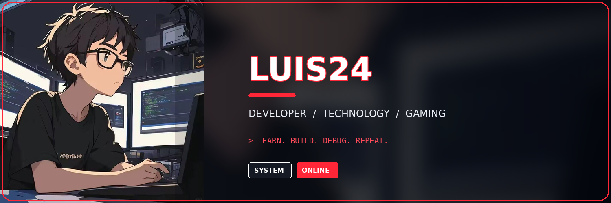
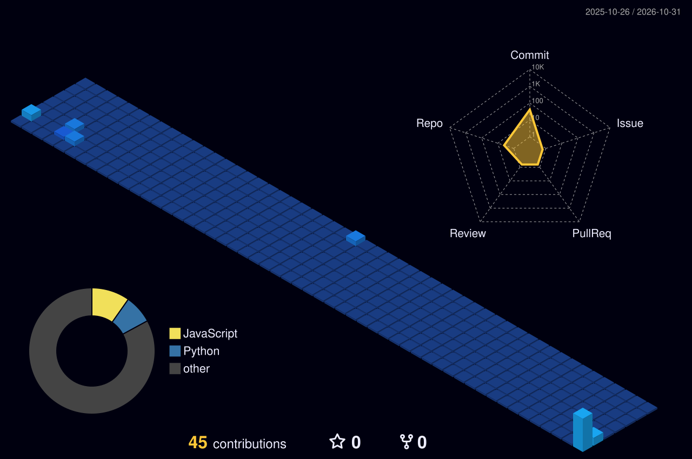
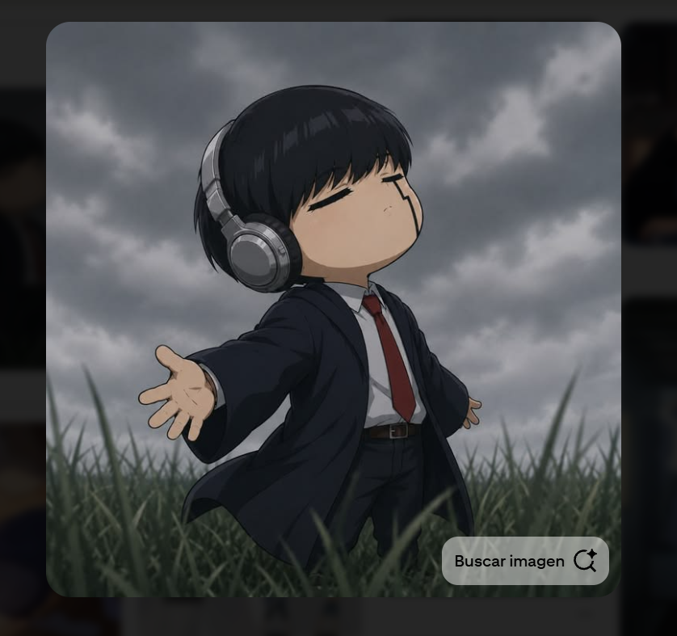
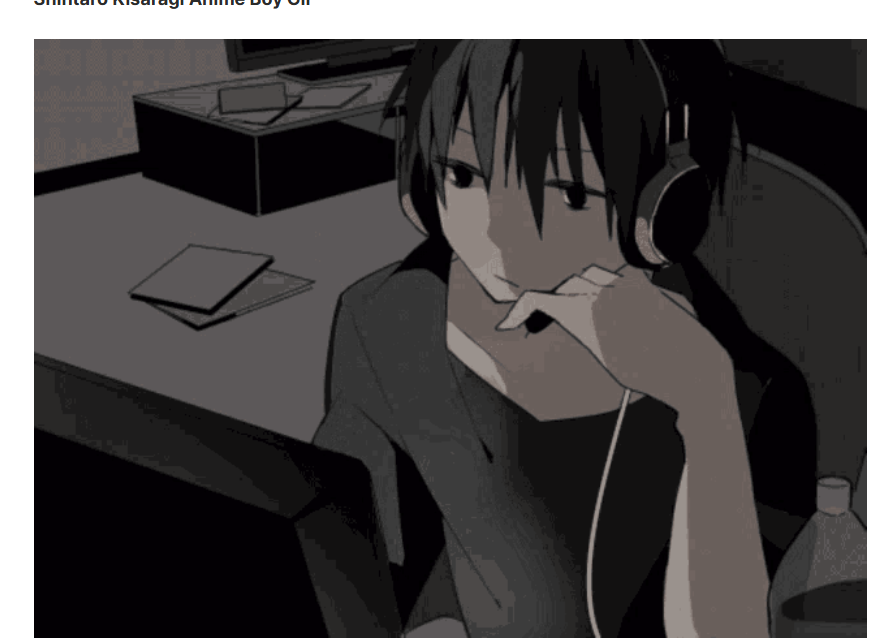

------------------------------------------------------------------------

## 👨‍💻 Sobre mí

- 🎓 Estudiante de Ingeniería de Sistemas.
- 💻 Interesado en desarrollo de software, desarrollo web y redes.
- ⚙️ Explorando automatización, infraestructura en la nube e
  inteligencia artificial.
- 🚀 Aprendiendo y construyendo proyectos constantemente.

## 🧰 Tecnologías

## 🚀 Proyectos

| Proyecto                   | Tecnología       |
|----------------------------|------------------|
| Detector de señales — v1.1 | Jupyter Notebook |
| Usuario de EcoRewards      | Java             |
| Academia Foxus             | CSS              |
| chathot12                  | TypeScript       |
| APP-RESTAURANTE            | TypeScript       |

## 📊 GitHub

## 🧊 Perfil 3D

## 🐍 MY CONTRIBUTION SNAKE

## 🎧 Anime coding corner

------------------------------------------------------------------------

**Gracias por visitar mi perfil. ¡Nos vemos en el código!** ⚡

`while (alive) { learn(); build(); repeat(); }`

